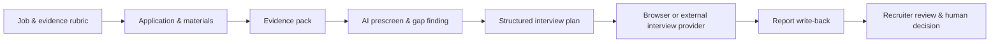
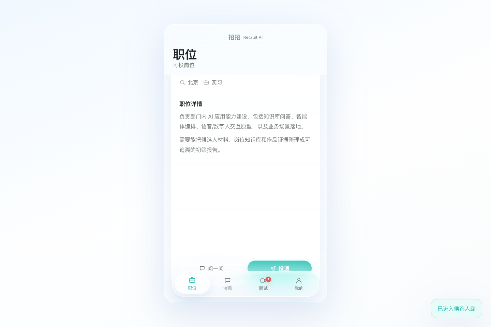
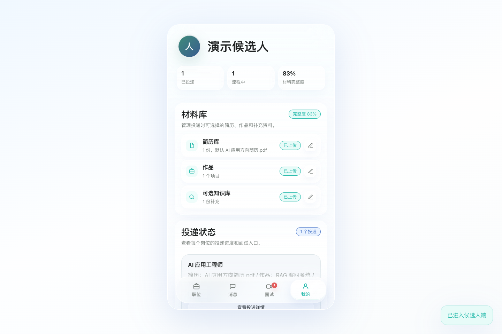
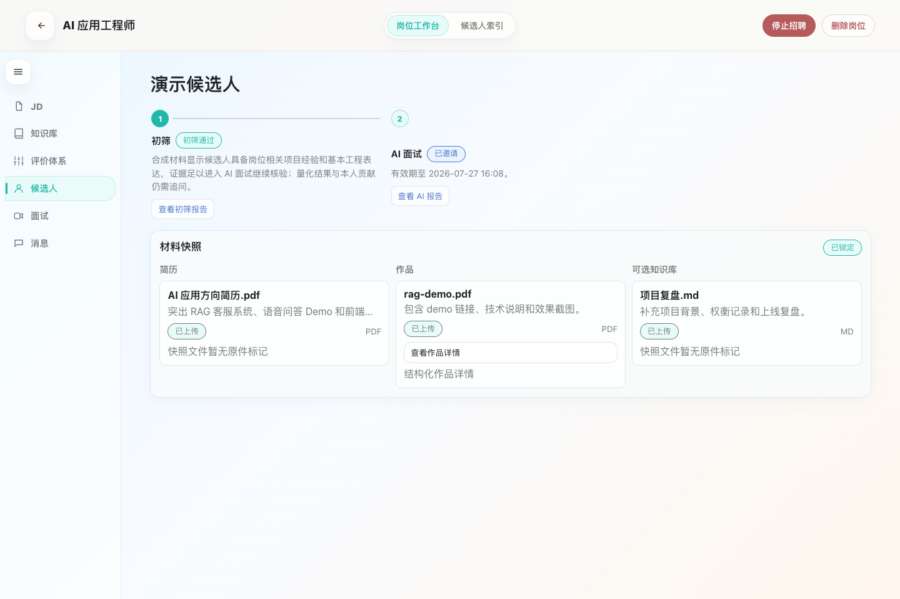
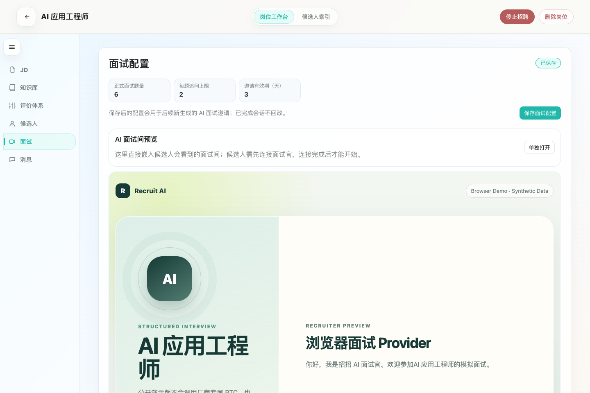
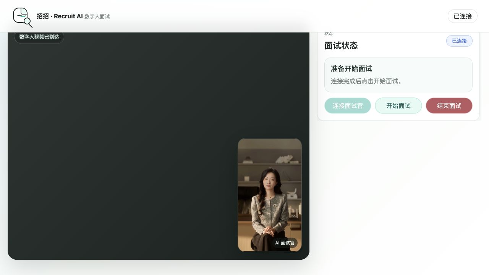
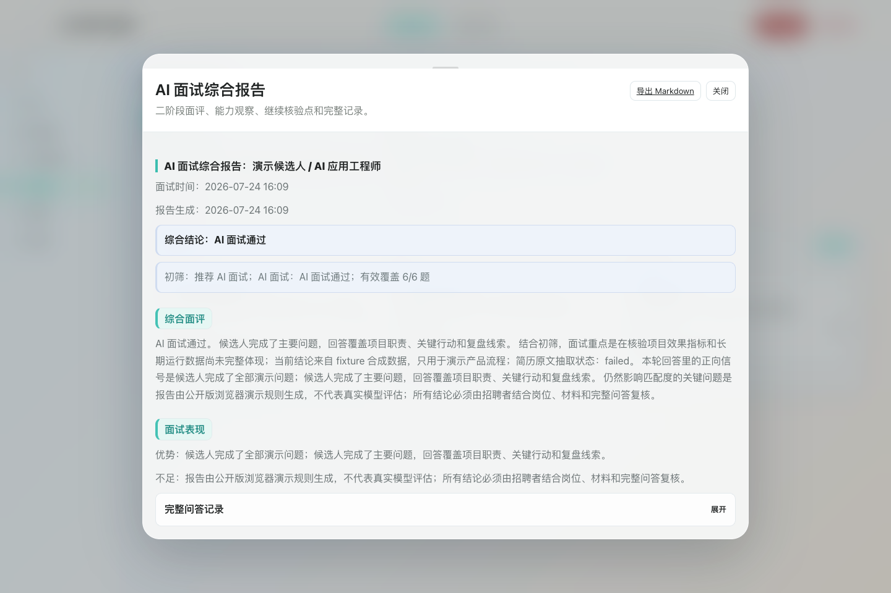
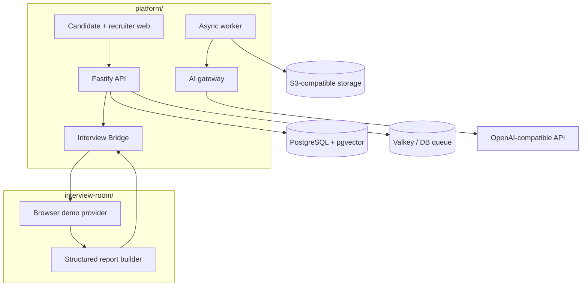

<div align="center">

[中文](README.md) · [English](README.en.md)

# 在场 · 招聘版

### 招招 · Recruit AI Platform

**Decisions may differ. Evidence must stay present.**

An open-source, evidence-first AI recruiting platform that connects job criteria, candidate materials, AI prescreening, structured interviews, report write-back, and human decisions in one traceable workflow.

</div>

<p align="center">
  <a href="#how-the-product-works">Product tour</a> ·
  <a href="#why-this-is-not-another-ai-resume-scorer">Why it is different</a> ·
  <a href="#try-it-locally">Try it</a> ·
  <a href="docs/architecture.md">Architecture</a> ·
  <a href="docs/privacy-and-fairness.md">Privacy & fairness</a>
</p>

> Every bundled job, candidate, and report is synthetic. The default demo needs no external AI key and never touches real candidate data. The digital-human visual demonstrates an optional external interview provider; its vendor implementation, credentials, and proprietary SDKs are not distributed in this repository.

## What it is

Many recruiting AI products solve one isolated problem: parse a resume, produce a score, or run a conversation. The harder problem is preserving the reasoning behind a hiring decision:

- What is the role actually evaluating?
- Which candidate material supports a conclusion?
- What did AI find, and what remains uncertain?
- Why did the interview ask those questions?
- How does the report return to the same candidate context?
- Who made the final decision, based on which evidence?

**在场 · 招聘版** turns information scattered across an ATS, documents, chat threads, and interview tools into one evidence chain. AI organizes, compares, and asks follow-up questions; accountable people make the decisions.

## Why this is not another AI resume scorer

| | Traditional ATS | Point AI screener | 在场 · 招聘版 |
| --- | --- | --- | --- |
| Primary focus | Workflow states and forms | One model output | The evidence chain from job criteria to interview report |
| Basis for conclusions | Reviewers search manually | Often a score or summary | Material snapshots, cited evidence, gaps, and conclusions remain separate |
| Interview handoff | Usually an external jump | Rarely included | Plans, session warm-up, and structured report write-back |
| Traceability | Records what happened | Difficult to reproduce | Records why a judgment was made and which materials were used |
| Decision boundary | Depends on configuration | Scores can become decisions | AI supplies evidence; people own progression, rejection, and offers |
| Integration | Fixed system | Often tied to one model | OpenAI-compatible models plus a stable Interview Bridge |

### Product advantages

1. **Evidence first, not score first**

   Rubrics, candidate materials, citations, AI conclusions, and unresolved gaps remain distinct. Reviewers can agree or disagree without trusting an unexplained overall score.

2. **One recruiting loop, not isolated AI features**

   The role, application, evidence pack, prescreen, interview plan, interview runtime, and report all share the same candidate context.

3. **The interview validates evidence instead of starting over**

   Gaps found during prescreening become structured interview questions. Results are written back against the original rubric, reducing repeated reading and context loss.

4. **People stay in the decision loop**

   The platform does not automatically reject or hire candidates. AI output is a reviewable working paper; the accountable recruiter makes the final call.

5. **Demo-ready and provider-neutral**

   A keyless fixture runs the full product loop. Production integrations use a small Bridge contract, so the product is not locked to one avatar, speech, or RTC vendor.

## The complete recruiting loop



The system keeps context present at every step without presenting model output as an objective judgment about a person.

## How the product works

### 1. Keep the role criteria present

Candidates see a clear role, while recruiters maintain the JD, supporting knowledge, and evaluation rubric under the same job. AI processing and interview questions use this shared standard instead of improvising a new one.

<p align="center">
  
</p>

### 2. Let candidates represent themselves with complete materials

A resume is only one source of evidence. Candidates can add work samples, project notes, and supporting knowledge. The system locks the material snapshot used for evaluation so the underlying evidence does not quietly change.

<p align="center">
  
</p>

### 3. AI organizes evidence; recruiters see its basis and gaps

The workbench keeps prescreen findings, cited material, the locked snapshot, and unresolved questions in one candidate context. Reviewers see more than pass or fail: they see why a conclusion was made and what still needs verification.

<p align="center">
  
</p>

### 4. Turn evidence gaps into an interview plan

Unverified capabilities become structured questions, and the interview session is warmed up automatically. Interview preparation stays connected to prescreening without forcing the recruiter to operate the system before results are ready.

<p align="center">
  
</p>

### 5. Swap interview providers without changing the recruiting workflow

The public edition includes a browser demo and can connect to external digital-human, speech, or RTC services through the Interview Bridge. The visual below shows an optional external digital-human flow; it receives the avatar stream only, with the local camera and microphone disabled.

<p align="center">
  
</p>

### 6. Write the report back to the original evaluation context

When the interview ends, the provider posts a structured report through a callback. Recruiters can compare the rubric, source materials, prescreen judgment, and interview evidence before making a human decision.

<p align="center">
  
</p>

## Who it is for

| Actor | Main job | What the platform provides |
| --- | --- | --- |
| Recruiter / hiring manager | Define criteria, review evidence, make decisions | A unified workbench, evidence snapshots, gap prompts, structured reports |
| Candidate | Understand the role, submit materials, interview | A coherent application flow, material supplements, a clear interview journey |
| Platform and AI team | Connect models, interview services, and enterprise systems | Provider-neutral interfaces, schema validation, async jobs, callback contracts |

## Capability boundaries

| Capability | Fixture mode | OpenAI-compatible / external provider |
| --- | --- | --- |
| Job definition and evaluation rubric | Included | Included |
| Resume, work samples, supporting material | Synthetic | User-provided |
| Evidence pack and structured prescreen | Deterministic fixture | Model-generated and schema validated |
| Interview plan | Deterministic fixture | Model-generated and schema validated |
| Interview runtime | Browser demo | Browser demo or external provider |
| Structured report write-back | Included | Included |
| Final hiring decision | Human only | Human only |

## Privacy, fairness, and human decisions

- Candidate materials are sensitive personal data; apply purpose limitation, least privilege, retention limits, and deletion workflows.
- Protected attributes or proxy variables must not automate hiring decisions.
- A model score is supporting evidence, not an objective measure of a person.
- Rejection, progression, and offers require an accountable human reviewer.
- Candidates should be able to correct materials, request human review, and understand how automated tools were used.
- Fixture output is synthetic and must never be presented as a real assessment.

Read the full [privacy and fairness guidance](docs/privacy-and-fairness.md).

## Architecture



The main platform and interview runtime communicate through a small provider contract. Vendor-specific RTC, avatar, voice, application IDs, and credentials are not included. See the [architecture](docs/architecture.md) and [provider interface](docs/provider-interface.md).

## Try it locally

Running the project is one way to experience the product, not the center of this README. The default fixture generates a synthetic job, candidate, evidence pack, and report without any external AI key.

Prerequisites: Node.js 22+, pnpm 10+, and Docker Compose.

```bash
cp .env.example .env
pnpm install
pnpm demo
```

Open the candidate app at `http://127.0.0.1:5173/candidate`, recruiter app at `http://127.0.0.1:5173/admin`, or interview preview at `http://127.0.0.1:5174/?preview=1`.

Useful commands: `pnpm stop`, `pnpm demo:data`, `pnpm check`, and `pnpm test:e2e`. See [.env.example](.env.example) for live model settings.

## Stable Bridge contract

```http
POST /api/agent-sessions
GET  /api/agent-sessions/:sessionId
POST /api/interview-bridge/status-callback
GET  /api/health
GET  /healthz
```

`POST /api/agent-sessions` receives a `projectSnapshot`, interview plan, and callback metadata. The provider returns a session and posts a structured report when complete. Health endpoints expose modes and readiness only—never keys, private paths, or internal URLs.

See [docs/provider-interface.md](docs/provider-interface.md) for payload examples and lifecycle rules.

## Roadmap

- [x] Synthetic, keyless end-to-end fixture
- [x] Evidence pack, prescreen, interview plan, and report write-back
- [x] Provider-neutral browser interview implementation
- [x] Chinese and English product documentation
- [x] Apache-2.0 open-source license
- [ ] Publish `v0.1.0-public-preview`
- [ ] Add optional, separately licensed provider adapters
- [ ] Expand bias evaluation, accessibility, and deletion tests

## Contributing, license, and security

The project is licensed under [Apache-2.0](LICENSE). Third-party components and optional provider boundaries are documented in [THIRD_PARTY_NOTICES.md](THIRD_PARTY_NOTICES.md).

Read [CONTRIBUTING.md](CONTRIBUTING.md) before opening a change. Report security issues through GitHub private vulnerability reporting as described in [SECURITY.md](SECURITY.md); do not disclose sensitive details in a public issue.
