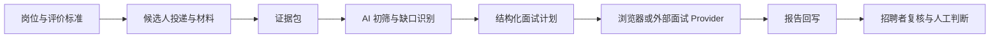
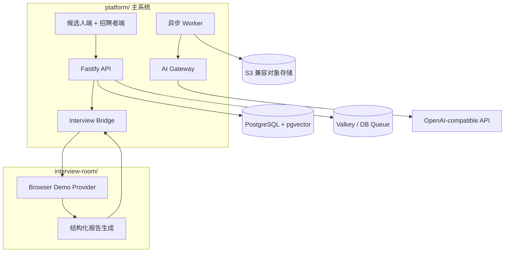

<div align="center">

[中文](README.md) · [English](README.en.md)

# 在场 · 招聘版

### 招招 · Recruit AI Platform

**判断可以有分歧，证据必须在场。**

一套以证据为中心的开源 AI 招聘协作平台：把岗位标准、候选人材料、AI 初筛、结构化面试、报告回写与人工决策连成一条可追溯的招聘链路。

</div>

<p align="center">
  <a href="#产品如何工作">产品走读</a> ·
  <a href="#为什么不是另一个-ai-简历打分器">产品优势</a> ·
  <a href="#本地体验">本地体验</a> ·
  <a href="docs/architecture.md">技术架构</a> ·
  <a href="docs/privacy-and-fairness.md">隐私与公平性</a>
</p>

> 所有内置岗位、候选人和报告均为合成数据。默认演示不需要外部 AI 密钥，也不会接触真实候选人数据。数字人画面用于展示可选的外部面试 Provider；其厂商实现、凭据和专属 SDK 不在本仓库中分发。

## 这是什么

很多招聘 AI 只回答一个局部问题：解析一份简历、生成一个分数，或安排一次对话。真正困难的是让一次招聘判断有来龙去脉：

- 岗位到底在评什么；
- 某个结论来自候选人的哪份材料；
- AI 发现了什么，又缺少什么；
- 面试为什么问这些问题；
- 报告如何回到同一个候选人上下文；
- 最终是谁基于哪些证据作出了决定。

**在场 · 招聘版**把这些原本散落在 ATS、文档、聊天记录和面试工具里的信息组织成同一条证据链。AI 负责整理、比对和追问，人负责判断并承担决策责任。

## 为什么不是另一个 AI 简历打分器

| | 传统 ATS | 单点 AI 筛选工具 | 在场 · 招聘版 |
| --- | --- | --- | --- |
| 关注对象 | 流程状态与表单 | 一次模型输出 | 从岗位标准到面试报告的完整证据链 |
| 结论依据 | 依赖人工翻找 | 常停留在分数或摘要 | 材料快照、证据引用、缺口与结论分开呈现 |
| 面试衔接 | 通常外部跳转 | 很少覆盖 | 自动生成计划、预热会话、回写结构化报告 |
| 可追溯性 | 记录“做过什么” | 难复现 | 记录“为什么这样判断”及当时使用的材料 |
| 决策边界 | 由流程配置决定 | 容易把分数当决定 | AI 只提供辅助证据，推进、淘汰与录用均由人决定 |
| 接入方式 | 固定系统 | 常绑定单一模型 | OpenAI-compatible 模型 + 稳定 Interview Bridge |

### 产品优势

1. **证据优先，而不是分数优先**

   岗位评价标准、候选人材料、证据引用、AI 结论和待核实项彼此分离。招聘者可以同意或推翻结论，而不用相信一个来历不明的总分。

2. **完整闭环，而不是孤立的 AI 功能**

   从岗位、投递、材料包、初筛、面试计划，到面试执行和报告回写，共用同一份候选人上下文。

3. **面试是验证证据，不是重新开始**

   初筛阶段发现的缺口会变成结构化面试问题；面试报告再按原评价标准回写，减少重复阅读和上下文丢失。

4. **人始终在决策环节**

   系统不会自动发出淘汰或录用决定。AI 输出是可复核的工作底稿，最终判断属于明确负责的招聘者。

5. **可演示，也可接真实 Provider**

   无密钥 fixture 模式可以跑通完整产品链路；生产路径通过小型 Bridge 契约接入模型和外部面试服务，不把产品锁死在某个数字人或语音厂商上。

## 完整招聘闭环



系统保留每一步的上下文，但不会把模型输出包装成“客观的人才结论”。

## 产品如何工作

### 1. 先让岗位标准在场

候选人看到清晰的岗位信息；招聘者在同一岗位下维护 JD、知识材料与评价标准。后续 AI 处理和面试提问都以这套标准为依据，而不是临时发挥。

<p align="center">
  
</p>

### 2. 让候选人用完整材料表达自己

简历只是证据的一部分。候选人可以补充作品、项目说明和知识材料；系统锁定投递时的材料快照，避免评价过程中材料悄然变化。

<p align="center">
  
</p>

### 3. AI 整理证据，招聘者看见依据与缺口

工作台把初筛结论、引用材料、材料快照和待核实项放在同一候选人上下文中。招聘者看到的不只是“通过/不通过”，而是结论为什么成立、哪里还需要追问。

<p align="center">
  
</p>

### 4. 从证据缺口生成面试计划

系统把待核实能力变成结构化面试问题，并自动完成面试会话预热。面试准备不再与初筛割裂，招聘者也无需在结果出来前反复操作。

<p align="center">
  
</p>

### 5. 面试 Provider 可以替换，招聘主链路保持稳定

公共版自带浏览器演示实现，也可以通过 Interview Bridge 接入外部数字人、语音或 RTC 服务。下图展示的是可选外部数字人链路；截图仅接收数字人画面，本机摄像头和麦克风均未开启。

<p align="center">
  
</p>

### 6. 报告回到原来的评价上下文

面试结束后，Provider 通过回调写回结构化报告。招聘者可以对照岗位标准、材料证据、初筛判断和面试表现进行人工复核，而不是收到一份与前序流程脱节的总结。

<p align="center">
  
</p>

## 谁会使用它

| 角色 | 主要任务 | 系统提供什么 |
| --- | --- | --- |
| 招聘者 / 用人经理 | 定义标准、复核证据、作出决定 | 统一工作台、证据快照、缺口提示、结构化报告 |
| 候选人 | 了解岗位、提交材料、参加面试 | 连贯的投递体验、材料补充入口、明确的面试流程 |
| 平台与 AI 工程团队 | 接入模型、面试服务和企业系统 | Provider-neutral 接口、Schema 校验、异步任务与回调契约 |

## 能力边界

| 能力 | Fixture 演示模式 | OpenAI-compatible / 外部 Provider |
| --- | --- | --- |
| 岗位定义与评价标准 | 已包含 | 已包含 |
| 简历、作品和补充资料 | 合成数据 | 用户提供 |
| 证据包与结构化初筛 | 固定、可重复 | 模型生成并做 Schema 校验 |
| 面试计划 | 固定、可重复 | 模型生成并做 Schema 校验 |
| 面试执行 | 浏览器 Demo | 浏览器 Demo 或外部 Provider |
| 结构化报告回写 | 已包含 | 已包含 |
| 最终招聘决定 | 仅人工 | 仅人工 |

## 隐私、公平性与人工决策

- 候选人材料属于敏感个人数据，应执行目的限制、最小权限、保留期限与删除流程。
- 不得利用受保护属性或其代理变量自动决定候选人去留。
- 模型分数是辅助证据，不是对人的客观度量。
- 淘汰、推进和录用必须由明确负责的招聘者决定。
- 候选人应能更正材料、请求人工复核，并了解自动化工具如何参与流程。
- Fixture 输出是合成结果，不得冒充真实候选人评价。

详见[隐私与公平性说明](docs/privacy-and-fairness.md)。

## 技术架构



主系统与面试运行时只通过小型 Provider 契约通信。公共仓库不包含厂商专属 RTC、形象、声音、应用 ID 或凭据。详见[架构说明](docs/architecture.md)与[Provider 接口](docs/provider-interface.md)。

## 本地体验

启动只是体验产品的一种方式。默认 fixture 模式会生成合成岗位、候选人、证据包和报告，不需要任何外部 AI 密钥。

前置条件：Node.js 22+、pnpm 10+、Docker Compose。

```bash
cp .env.example .env
pnpm install
pnpm demo
```

打开候选人端 `http://127.0.0.1:5173/candidate`、招聘者端 `http://127.0.0.1:5173/admin`，或面试预览 `http://127.0.0.1:5174/?preview=1`。

常用命令：`pnpm stop`、`pnpm demo:data`、`pnpm check`、`pnpm test:e2e`。真实模型模式和环境变量见 [.env.example](.env.example)。

## 稳定的 Bridge 接口

```http
POST /api/agent-sessions
GET  /api/agent-sessions/:sessionId
POST /api/interview-bridge/status-callback
GET  /api/health
GET  /healthz
```

`POST /api/agent-sessions` 接收 `projectSnapshot`、面试计划和回调信息；面试 Provider 返回会话，并在完成后回写结构化报告。健康接口只返回运行模式和依赖就绪情况，不返回密钥、个人路径或内部地址。

完整示例见 [docs/provider-interface.md](docs/provider-interface.md)。

## Roadmap

- [x] 无密钥、可重复的合成数据完整闭环
- [x] 证据包、初筛、面试计划与报告回写
- [x] 厂商无关的浏览器面试实现
- [x] 中英文产品文档
- [x] Apache-2.0 开源许可证
- [ ] 发布 `v0.1.0-public-preview`
- [ ] 以独立授权 Adapter 的形式增加可选 Provider
- [ ] 扩充偏差评测、无障碍和数据删除测试

## 贡献、许可与安全

项目采用 [Apache-2.0](LICENSE) 许可证。第三方组件和可选 Provider 边界见 [THIRD_PARTY_NOTICES.md](THIRD_PARTY_NOTICES.md)。

提交改动前请阅读 [CONTRIBUTING.md](CONTRIBUTING.md)。安全问题请按 [SECURITY.md](SECURITY.md) 使用 GitHub 私密漏洞报告，不要在公开 Issue 中披露敏感信息。
