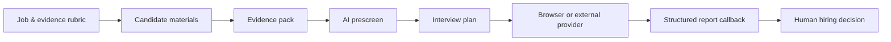
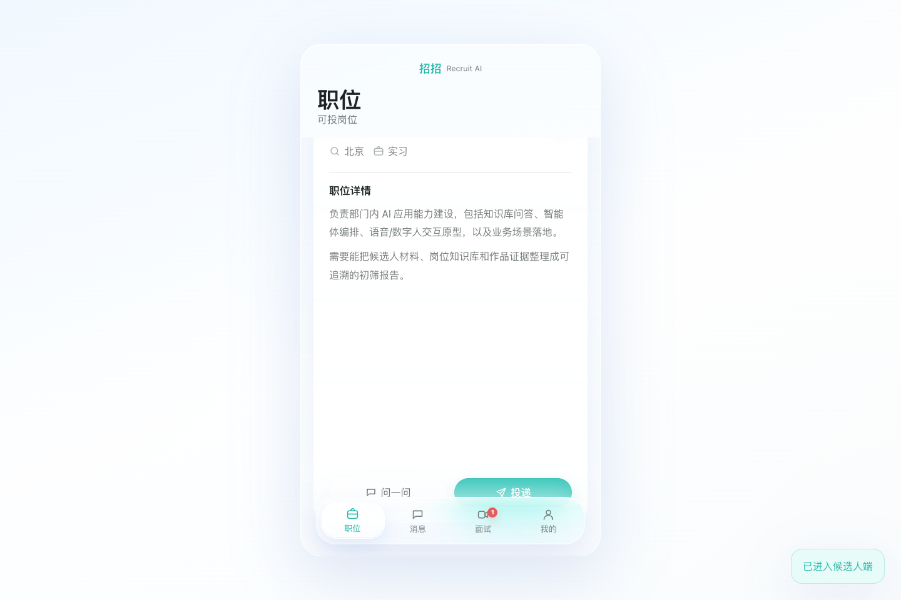
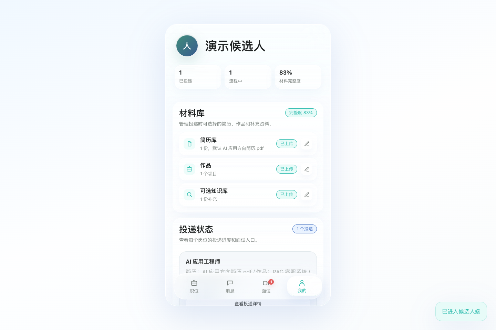
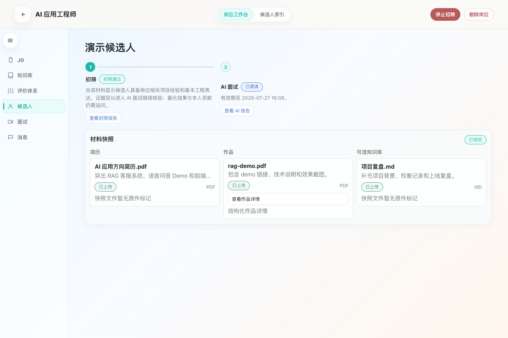
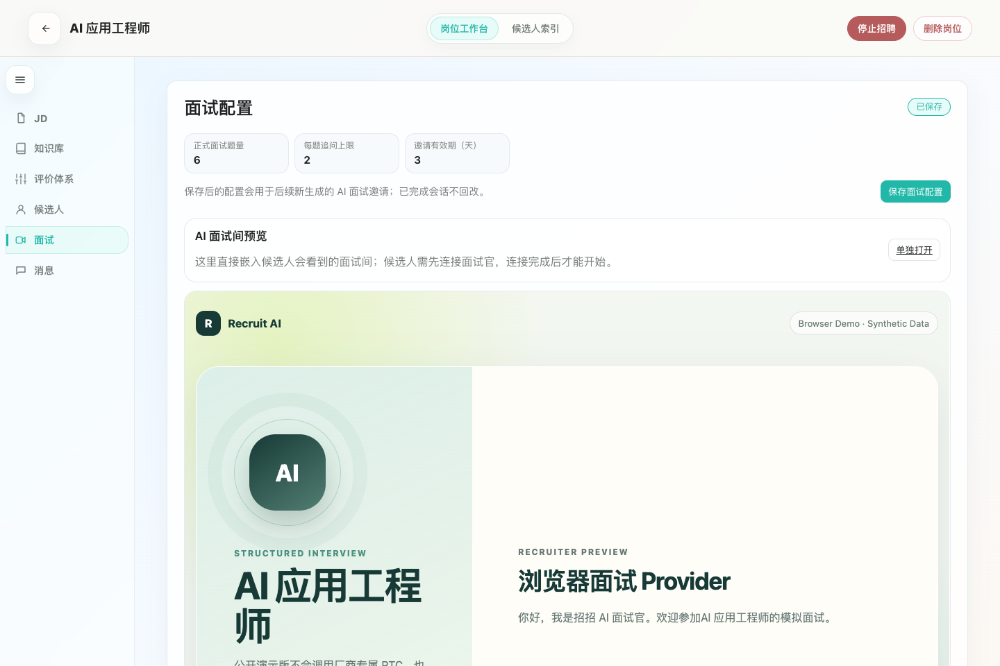
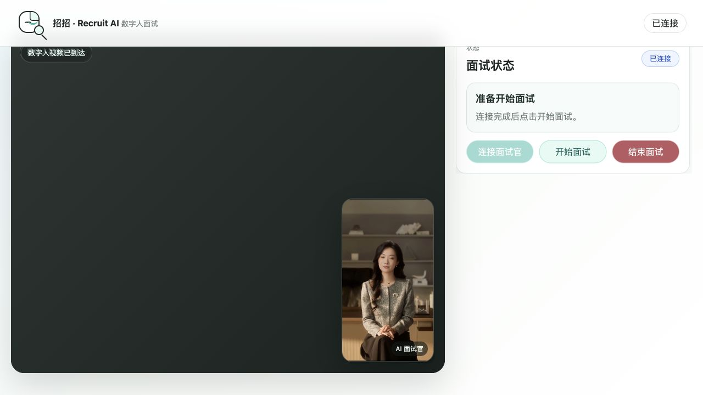
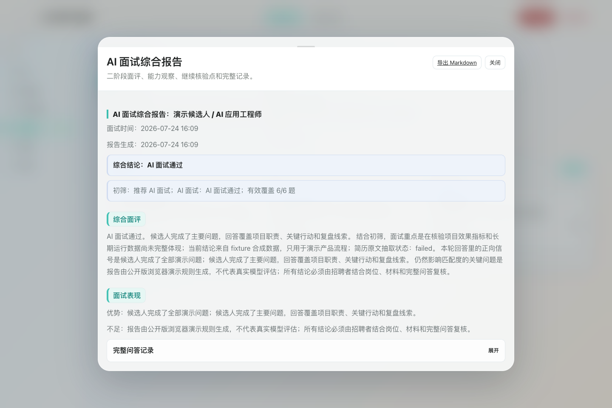
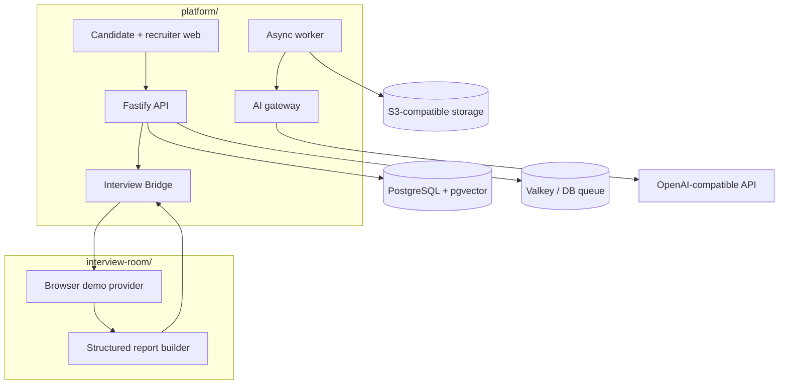

# Recruit AI Platform

[简体中文](README.zh-CN.md) · [Architecture](docs/architecture.md) · [Provider interface](docs/provider-interface.md) · [Privacy & fairness](docs/privacy-and-fairness.md)

An evidence-first AI recruiting platform that connects job criteria, candidate materials, structured screening, interview orchestration, report write-back, and human review.

> Public-release candidate: all bundled examples are synthetic, `fixture` mode needs no external AI key, and the vendor-neutral browser interview runtime is included. Keep the repository **Private** until code ownership and third-party rights are confirmed.

## The complete recruiting loop



The platform does not treat model output as a hiring decision. It organizes evidence, exposes gaps, runs a structured interview workflow, and returns the result to a recruiter for review.

## Product tour

| Candidate job feed | Candidate materials |
| --- | --- |
|  |  |
| Evidence-based recruiter workbench | Interview orchestration |
|  |  |
| Digital-human interview room | Structured report written back |
|  |  |

All product data shown is synthetic. The digital-human screenshot was captured from the local runtime in subscriber-only mode with the camera and microphone disabled. No production candidate data, personal desktop or browser chrome, chat records, or historical runtime captures are used.

## What is included

| Capability | Fixture mode | OpenAI-compatible mode |
| --- | --- | --- |
| Job definition and evaluation rubric | Included | Included |
| Candidate resume, portfolio, and knowledge materials | Synthetic | User-provided |
| Evidence pack and structured prescreen | Deterministic fixture | Model-generated, schema validated |
| Interview plan | Deterministic fixture | Model-generated, schema validated |
| Interview runtime | Browser demo | Browser demo or external provider |
| Structured report callback | Included | Included |
| Final decision | Human only | Human only |

## Architecture



The main system and interview runtime communicate through a small provider contract. Vendor-specific RTC, avatar, voice, application IDs, and credentials are intentionally not included. See [architecture](docs/architecture.md) and [provider interface](docs/provider-interface.md).

## Quick start

Prerequisites: Node.js 22+, pnpm 10+, Docker with Compose.

```bash
cp .env.example .env
pnpm install
pnpm demo
```

Open:

- Candidate: `http://127.0.0.1:5173/candidate`
- Recruiter: `http://127.0.0.1:5173/admin`
- Interview preview: `http://127.0.0.1:5174/?preview=1`

Stop everything with `pnpm stop`. Regenerate the synthetic dataset with `pnpm demo:data`.

## Demo and live provider modes

### `AI_MODE=fixture`

- Requires no external API key.
- Uses synthetic jobs, a synthetic candidate, and pre-generated schema-valid outputs.
- Clearly records the provider as `fixture`.
- Exists for product evaluation, tests, screenshots, and public demos.

### `AI_MODE=openai-compatible`

- Requires `AI_BASE_URL`, `AI_API_KEY`, and `AI_MODEL`.
- Uses the `/chat/completions` JSON interface.
- Fails explicitly when credentials are missing, provider calls fail, or outputs violate the schema.
- Never silently falls back to fixture output.

### Interview runtime

- `INTERVIEW_RUNTIME=browser-demo` uses the included typed-answer and browser speech-synthesis implementation.
- `INTERVIEW_RUNTIME=external` points the Bridge at a compatible external service through `INTERVIEW_BASE_URL` and `INTERVIEW_PUBLIC_BASE_URL`.

## Stable Bridge contract

The public contract keeps the integration surface deliberately small:

```http
POST /api/agent-sessions
GET  /api/agent-sessions/:sessionId
POST /api/interview-bridge/status-callback
GET  /api/health
GET  /healthz
```

`POST /api/agent-sessions` receives a `projectSnapshot`, interview plan, and callback metadata. The interview provider returns a session and eventually posts a structured report. Health endpoints expose modes and readiness only—never API keys, private paths, or configured internal URLs.

See [docs/provider-interface.md](docs/provider-interface.md) for payload examples and lifecycle rules.

## Privacy, fairness, and decision boundaries

- Candidate materials are sensitive personal data; use purpose limitation, access control, retention limits, and deletion workflows.
- Protected or proxy attributes must not be used to automate hiring decisions.
- A model score is supporting evidence, not an objective measure of a person.
- Rejections, progression, and offers require an accountable human reviewer.
- Candidates should be able to correct material, request human review, and understand how automated tools were used.
- Fixture output is synthetic and must never be presented as a real assessment.

Read the full [privacy and fairness guidance](docs/privacy-and-fairness.md).

## Commands

| Command | Purpose |
| --- | --- |
| `pnpm demo` | Start infrastructure, migrate, seed synthetic data, and run all services |
| `pnpm stop` | Stop application processes and local infrastructure |
| `pnpm demo:data` | Regenerate the synthetic fixture |
| `pnpm check` | Syntax checks plus public-tree sensitive-content scan |
| `pnpm test:e2e` | Full fixture flow: job → application → prescreen → interview → callback → human review |
| `pnpm media:capture` | Recreate synthetic README screenshots from a running capture instance |

## Roadmap

- [x] Synthetic, keyless end-to-end fixture
- [x] Evidence pack, prescreen, interview plan, and report callback
- [x] Provider-neutral browser interview implementation
- [x] English and Chinese documentation
- [ ] Confirm code ownership and third-party rights
- [ ] Add Apache-2.0 `LICENSE` after approval
- [ ] Publish `v0.1.0-public-preview`
- [ ] Add optional, separately licensed provider adapters
- [ ] Expand bias evaluation, accessibility, and deletion tests

## Contributing and security

Read [CONTRIBUTING.md](CONTRIBUTING.md) before opening a change. Report security issues through GitHub private vulnerability reporting as described in [SECURITY.md](SECURITY.md).

## License status

No open-source license is granted yet. This repository must remain Private until ownership and third-party authorization are confirmed. After approval, the intended release license is Apache-2.0. See [THIRD_PARTY_NOTICES.md](THIRD_PARTY_NOTICES.md).
