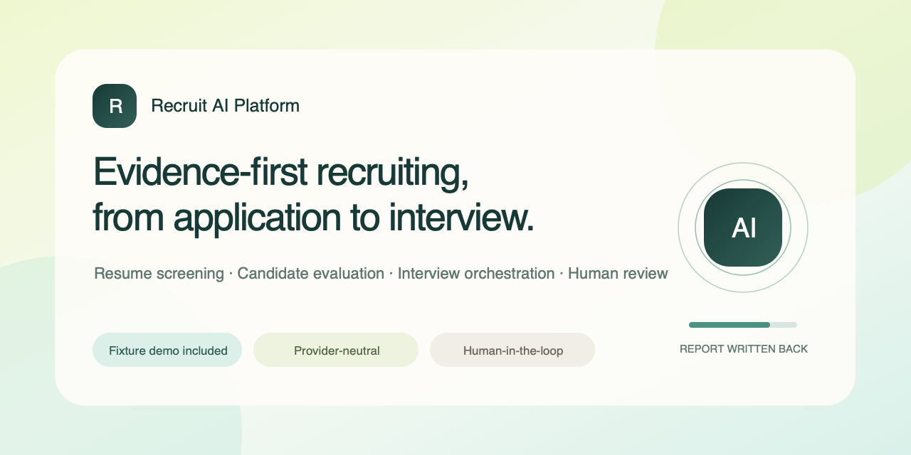
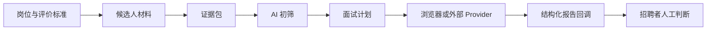
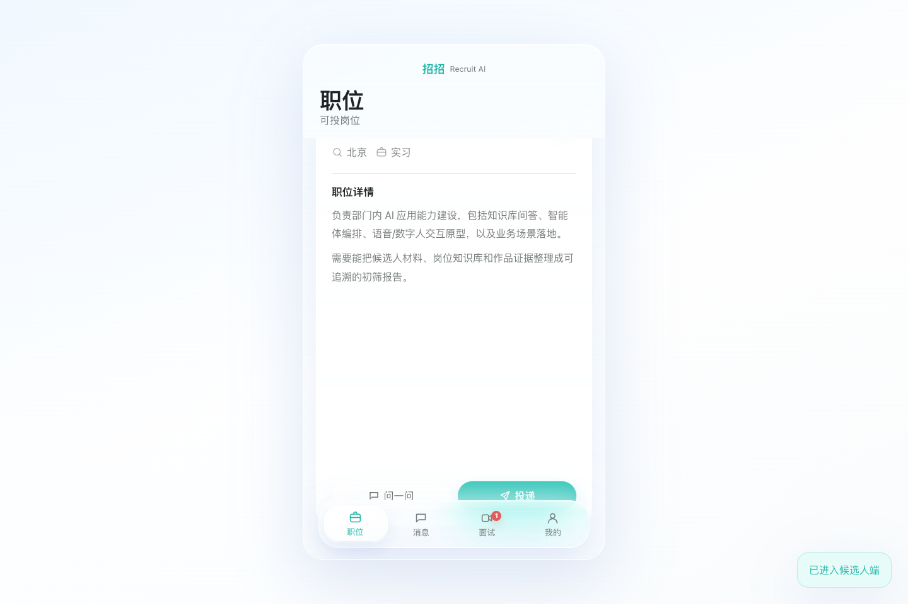
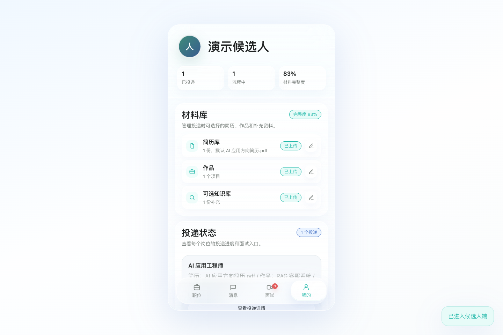
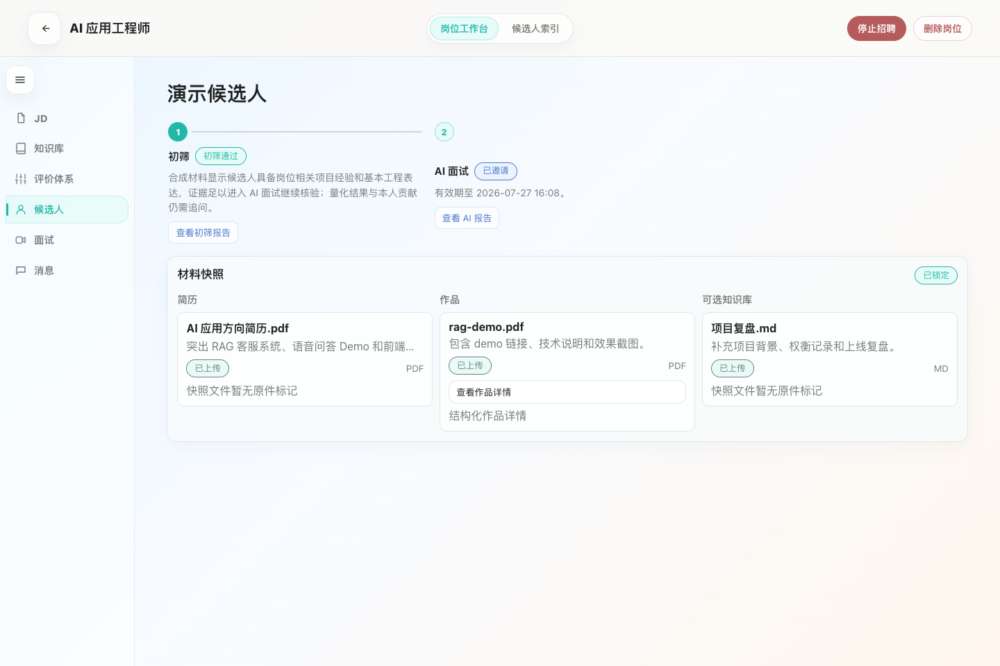
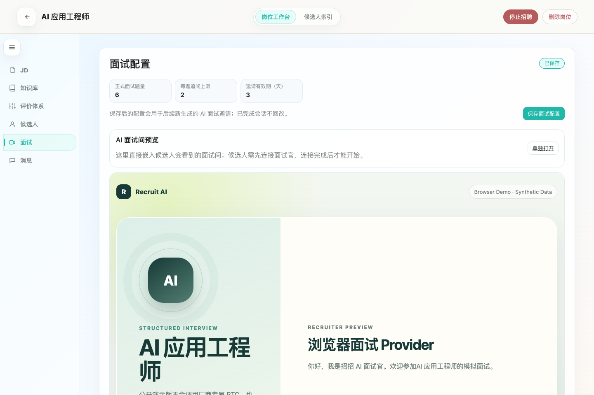
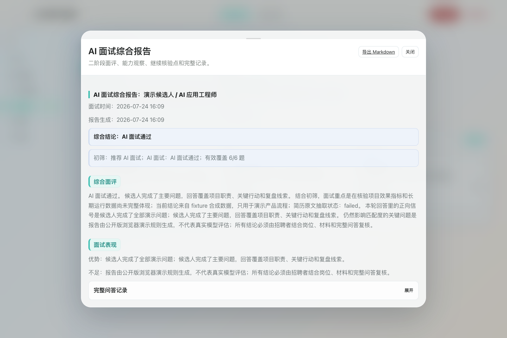
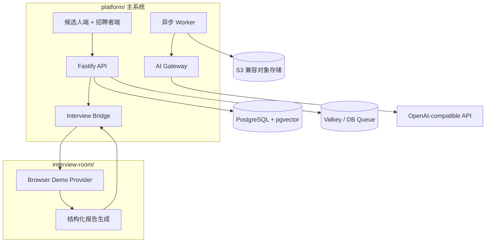

# Recruit AI Platform（招招）

[English](README.md) · [架构说明](docs/architecture.md) · [面试 Provider 接口](docs/provider-interface.md) · [隐私与公平性](docs/privacy-and-fairness.md)

一个以证据为中心的 AI 招聘平台，把岗位评价标准、候选人材料、结构化初筛、AI 面试编排、报告回写与人工判断连成完整闭环。

> 这是待公开版本：仓库内置数据全部为合成数据，`fixture` 模式无需任何外部 AI 密钥，且包含厂商无关的浏览器面试服务。代码权属与第三方授权确认前，请保持仓库 **Private**。



## 完整招聘闭环



平台不会把模型输出当作招聘决定。它负责整理证据、暴露缺口、执行结构化面试，并把结果交回招聘者复核。

## 产品截图

| 候选人岗位 Feed | 候选人材料库 |
| --- | --- |
|  |  |
| 招聘者证据评价工作台 | AI 面试编排 |
|  |  |
| 数字人面试间 | 结构化报告回写 |
|  |  |

所有产品数据均为合成数据。数字人截图来自本地运行链路，截图时使用仅接收数字人画面的模式，并关闭了本机摄像头和麦克风。仓库没有复用真实候选人数据、个人桌面或浏览器标签、聊天记录及历史 `.runtime` 图片。

## 功能矩阵

| 能力 | Fixture 演示模式 | OpenAI-compatible 模式 |
| --- | --- | --- |
| 岗位定义与评价标准 | 已包含 | 已包含 |
| 简历、作品和补充资料 | 合成数据 | 用户提供 |
| 证据包与结构化初筛 | 固定、可重复 | 模型生成并做 Schema 校验 |
| 面试计划 | 固定、可重复 | 模型生成并做 Schema 校验 |
| 面试执行 | 浏览器 Demo | 浏览器 Demo 或外部 Provider |
| 结构化报告回写 | 已包含 | 已包含 |
| 最终招聘决定 | 仅人工 | 仅人工 |

## 技术架构



主系统与面试运行时只通过小型 Provider 契约通信。首个公共版本不包含厂商专属 RTC、形象、声音、应用 ID 或凭据。详见[架构说明](docs/architecture.md)与[Provider 接口](docs/provider-interface.md)。

## 三步启动

前置条件：Node.js 22+、pnpm 10+、Docker Compose。

```bash
cp .env.example .env
pnpm install
pnpm demo
```

访问：

- 候选人端：`http://127.0.0.1:5173/candidate`
- 招聘者端：`http://127.0.0.1:5173/admin`
- 面试预览：`http://127.0.0.1:5174/?preview=1`

使用 `pnpm stop` 停止全部服务，使用 `pnpm demo:data` 重新生成合成演示数据。

## 演示模式与真实模型模式

### `AI_MODE=fixture`

- 不需要外部 API Key。
- 使用合成岗位、合成候选人和预生成的 Schema 合法输出。
- 模型调用日志会明确记录 Provider 为 `fixture`。
- 只用于产品体验、自动化测试、公开演示和截图。

### `AI_MODE=openai-compatible`

- 必须提供 `AI_BASE_URL`、`AI_API_KEY`、`AI_MODEL`。
- 使用 `/chat/completions` JSON 接口。
- 缺少密钥、Provider 调用失败或输出不符合 Schema 时会明确失败。
- 不会静默切换到 fixture 结果。

### 面试运行时

- `INTERVIEW_RUNTIME=browser-demo` 使用内置的键盘回答与浏览器语音朗读。
- `INTERVIEW_RUNTIME=external` 通过 `INTERVIEW_BASE_URL` 和 `INTERVIEW_PUBLIC_BASE_URL` 接入兼容的外部服务。

## 稳定的 Bridge 接口

公共版保留以下集成面：

```http
POST /api/agent-sessions
GET  /api/agent-sessions/:sessionId
POST /api/interview-bridge/status-callback
GET  /api/health
GET  /healthz
```

`POST /api/agent-sessions` 接收 `projectSnapshot`、面试计划和回调信息；面试 Provider 返回会话，并在完成后回写结构化报告。健康接口只返回运行模式和依赖就绪情况，绝不返回密钥、个人路径或配置的内部地址。

完整示例见 [docs/provider-interface.md](docs/provider-interface.md)。

## 隐私、公平性与人工决策边界

- 候选人材料属于敏感个人数据，应执行目的限制、最小权限、保留期限与删除流程。
- 不得利用受保护属性或其代理变量自动决定候选人去留。
- 模型分数是辅助证据，不是对人的客观度量。
- 淘汰、推进和录用必须由明确负责的招聘者决定。
- 候选人应能更正材料、请求人工复核，并了解自动化工具如何参与流程。
- Fixture 输出是合成结果，不得冒充真实候选人评价。

详见[隐私与公平性说明](docs/privacy-and-fairness.md)。

## 常用命令

| 命令 | 用途 |
| --- | --- |
| `pnpm demo` | 启动基础设施、迁移数据库、生成合成数据并运行所有服务 |
| `pnpm stop` | 停止应用进程和本地基础设施 |
| `pnpm demo:data` | 重建合成演示数据 |
| `pnpm check` | 语法检查与公共仓库敏感内容扫描 |
| `pnpm test:e2e` | 完整回归：岗位 → 投递 → 初筛 → 面试 → 回调 → 人工复核 |
| `pnpm media:capture` | 从合成演示实例重新生成 README 截图 |

## Roadmap

- [x] 无密钥、可重复的合成数据完整闭环
- [x] 证据包、初筛、面试计划与报告回写
- [x] 厂商无关的浏览器面试实现
- [x] 中英文文档
- [ ] 完成代码权属与第三方授权确认
- [ ] 获批后添加 Apache-2.0 `LICENSE`
- [ ] 发布 `v0.1.0-public-preview`
- [ ] 以独立授权 Adapter 的形式增加可选 Provider
- [ ] 扩充偏差评测、无障碍和数据删除测试

## 贡献与安全

提交改动前请阅读 [CONTRIBUTING.md](CONTRIBUTING.md)。安全问题请按 [SECURITY.md](SECURITY.md) 使用 GitHub 私密漏洞报告，不要公开披露。

## 当前许可证状态

当前尚未授予开源许可证。代码权属和第三方授权确认前，本仓库必须保持 Private；确认后计划使用 Apache-2.0。第三方组件见 [THIRD_PARTY_NOTICES.md](THIRD_PARTY_NOTICES.md)。
