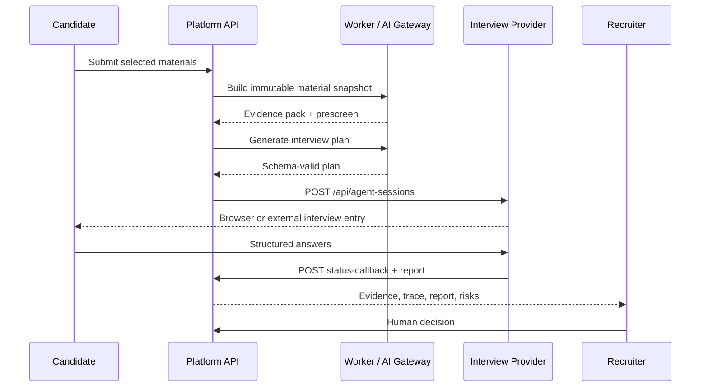

# Architecture

## Repository boundaries

```text
recruit-ai-platform/
├── platform/         candidate UI, recruiter UI, API, worker, storage
├── interview-room/   provider-neutral browser interview runtime
├── docs/             architecture, interfaces, deployment, governance
├── media/            synthetic screenshots, video, social preview
└── .github/          public CI and security automation
```

`platform/` is the source of truth for recruiting workflow state. `interview-room/` executes a prepared interview plan and returns a structured report; it does not own job, candidate, application, or hiring-decision state.

## Main workflow



## Core invariants

1. The application contains an immutable material snapshot.
2. Model output is schema validated before it changes workflow state.
3. Fixture mode is explicit and logged as `fixture`.
4. OpenAI-compatible mode never silently falls back to fixture output.
5. The interview provider receives a prepared `projectSnapshot`; it does not read private platform storage directly.
6. A callback must authenticate with the configured Bridge secret.
7. A completed interview report is supporting evidence, not the hiring decision.
8. Health endpoints expose readiness, not secrets or configured private addresses.

## Platform modules

### Candidate and recruiter web

The same Fastify process serves the candidate and recruiter surfaces. Candidate identity is deliberately minimal in the local preview. A production deployment must replace this with an approved identity and access model.

### API

The API owns jobs, candidates, material snapshots, applications, interview plans, attempts, reports, audit events, and human decisions.

### Worker

The worker processes evidence preparation and prescreen jobs. The default local stack uses Valkey through BullMQ; tests can use the database-backed queue.

### AI Gateway

The gateway maps platform inputs to an OpenAI-compatible chat-completions API and validates structured outputs. In `fixture` mode it returns bundled synthetic outputs through the same schemas.

### Interview Bridge

The Bridge creates provider sessions, generates candidate entry URLs, pulls completed sessions when necessary, accepts authenticated callbacks, and maps provider reports back into application state.

## Data services

- PostgreSQL stores transactional workflow state.
- pgvector is available for vector search paths.
- Valkey provides a local Redis-compatible queue.
- MinIO provides optional local S3-compatible object storage.
- Filesystem storage and database queue modes support lightweight tests.

## Provider isolation

The public repository contains no vendor-specific RTC, avatar, voice, application, or secret configuration. A future adapter should live outside the core runtime, implement the documented session and callback contract, and undergo independent ownership and license review.
